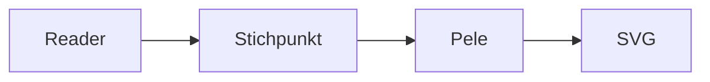
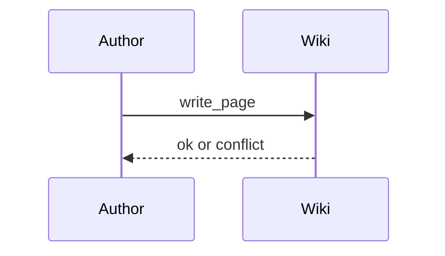
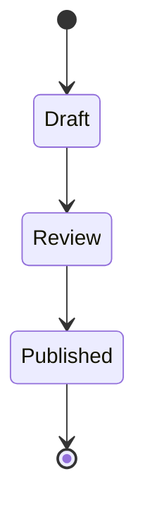

# Pele

Pele renders Stichpunkt's `mermaid` fences in the browser. It follows the active light or dark theme and adapts diagram layout to the available width.

The fence language stays `mermaid`, so existing notes keep working:

Sequence diagrams:

State diagrams:

See [[Features/Diagrams/Mermaid]] for directive compatibility and [[Features/Diagrams/Errors]] for error handling.
